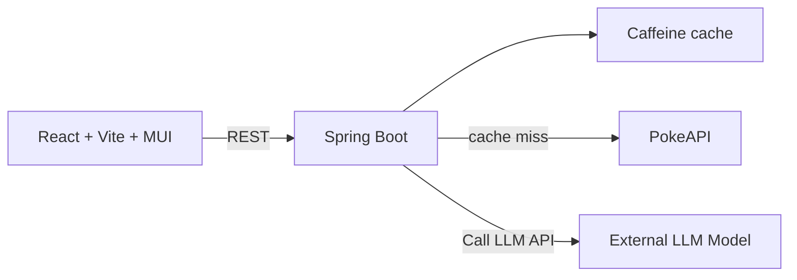

# Pokemon Index

A Pokemon browser built with React 18, Vite, Material UI, Spring Boot, and PokeAPI. Optional AI Q&A runs through external LLM Model.

## Architecture



The frontend calls Spring Boot, which retrieves and caches Pokemon data. For AI questions, the backend supplies Pokemon facts to LLM Model.

## Features

- Browse Pokemon with First, Previous, page selection, Next, and Last navigation.
- Search Pokemon by name and filter by type.
- View Pokemon types, measurements, and base stats.
- Read a species description and explore its evolution chain.
- Ask questions about a Pokemon using a local AI model.

## Prerequisites

- Java 21 and Maven
- Node.js and npm
- Internet access to PokeAPI
- External Kenari API key for AI features

## Run locally

Setup API Key and environment if you want to use AI Q&A:

```bash
export KENARI_MODEL=<MODEL-NAME>
export KENARI_API_KEY=<API-KEY>
export KENARI_CHAT_URL=<URL-KENARI-MESSAGE>
```

Start the backend in another terminal:

```bash
cd backend
mvn spring-boot:run
```

Start the frontend in another terminal:

```bash
cd frontend
npm install
npm run dev
```

Open the URL printed by Vite, normally <http://localhost:5173>.

## Configuration

Backend defaults are defined in `backend/src/main/resources/application.yml`. Override them with environment variables:

| Variable | Default | Purpose                  |
| --- | --- |--------------------------|
| `PORT` | `8080` | Backend port             |
| `POKEAPI_BASE_URL` | `https://pokeapi.co/api/v2` | Pokemon data source      |
| `CACHE_TTL` | `15m` | In-memory cache duration |
| `LLM_URL` | `kenari.id` | Kenari endpoint          |
| `LLM_MODEL` | `qwen2.5:3b` | LLM model             |
| `FRONTEND_ORIGIN` | `http://localhost:5173` | Allowed frontend origin  |

To configure the frontend API address, create `frontend/.env.local`:

```bash
VITE_API_BASE_URL=http://localhost:8080
```

Restart the relevant service after changing its configuration. Vite embeds `VITE_` values when building the frontend.

## API

| Action | Endpoint |
| --- | --- |
| Browse | `GET /api/pokemon?offset=0&limit=20` |
| Search and filter | `GET /api/pokemon?q=pika&type=electric` |
| Detail | `GET /api/pokemon/pikachu` |
| Species description | `GET /api/pokemon/pikachu/species` |
| Evolution chain | `GET /api/pokemon/pikachu/evolution` |
| AI explanation | `GET /api/pokemon/pikachu/explain` |
| AI Q&A | `POST /api/ai/ask` |

List results use zero-based `offset` and a page size of 20 in the frontend. The backend returns the total result count so the UI can calculate the last page.

Example AI question:

```bash
curl -f http://localhost:8080/api/ai/ask \
  -H "Content-Type: application/json" \
  -d '{"pokemon":"pikachu","question":"What type is it?"}'
```

The backend sends Pokemon facts and the question to kenari’s endpoint. AI answers may be inaccurate; verify important claims against the displayed facts.

## Tests

Run backend tests:

```bash
cd backend
mvn test
```

Run the service unit test alone:

```bash
mvn -Dtest=PokemonServiceTest test
```

Check the frontend:

```bash
cd frontend
npm run build
npm run lint
```

## Deployment

A static host can serve the built frontend. Spring Boot requires a host that runs persistent processes and require external LLM Model via API Key. Expose the backend over HTTPS, restrict CORS to the deployed frontend origin, and keep LLM model accessible only to the backend.